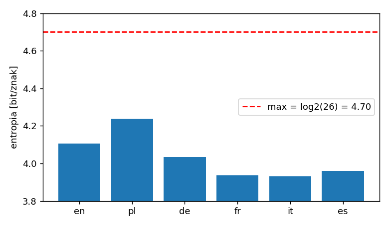
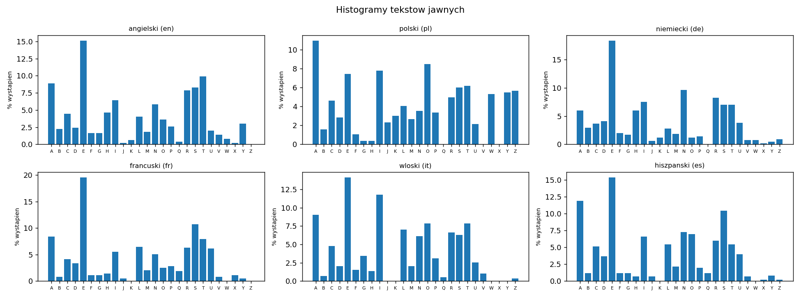
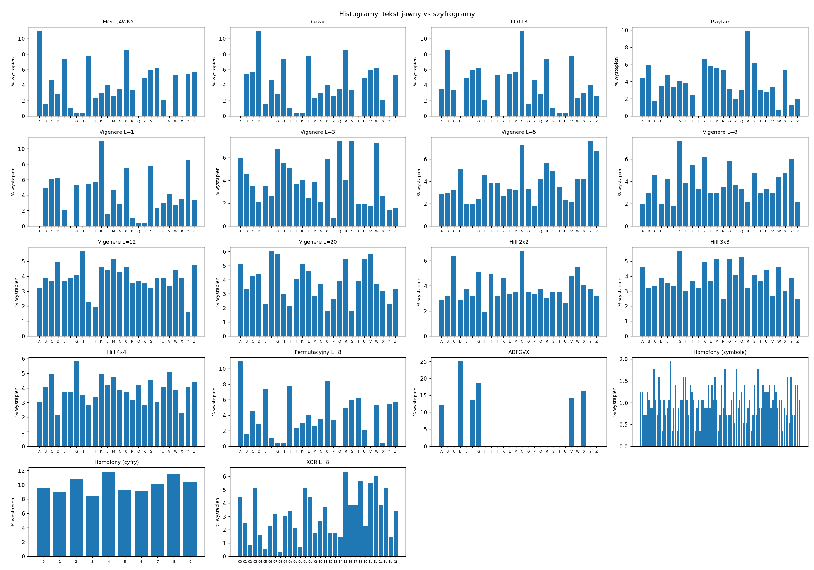
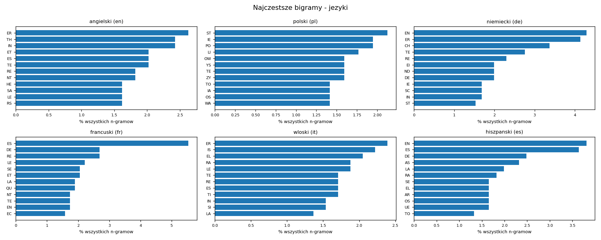
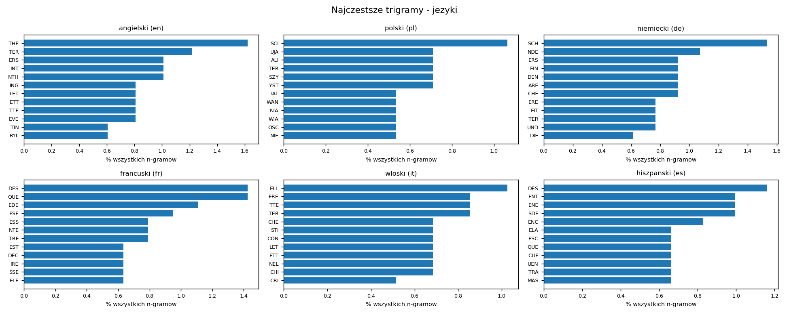
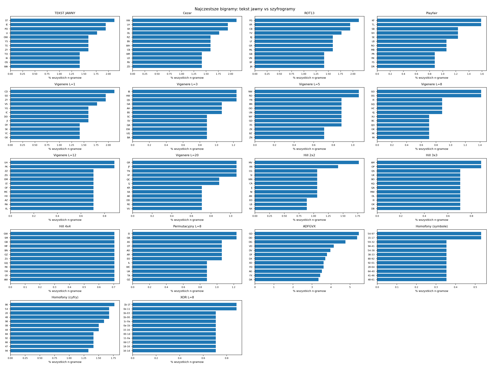
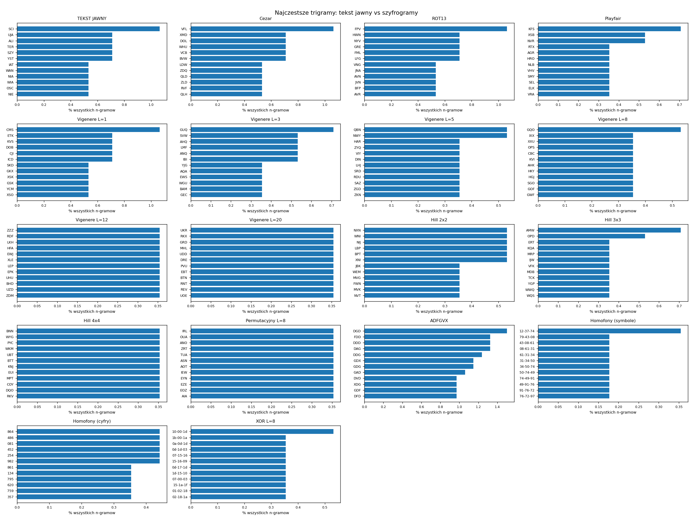
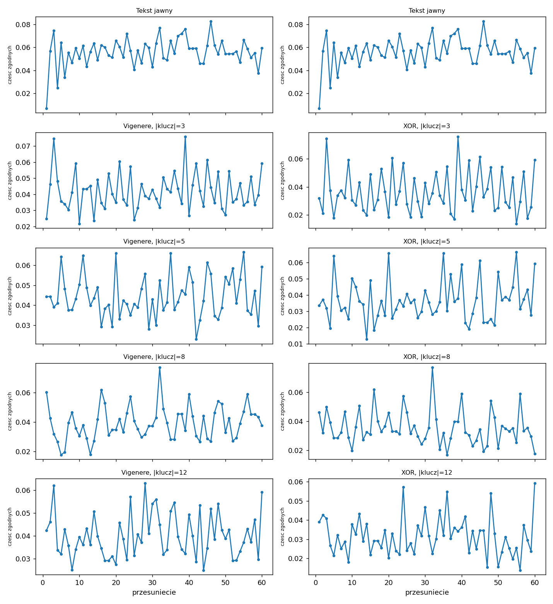

# Wyniki eksperymentow - Laboratorium nr 2

Ziarno generatora: 42. Tekst jawny: polski, 566 znakow.

## Zadanie 1.2 - wlasciwosci wybranych algorytmow

| Algorytm | Klucz | Przestrzen kluczy | Klucze slabe / uwagi | Metody lamania |
|---|---|---|---|---|
| Cezar | klucz k in 0..25 | 26 (2^4.7) | k=0 (tozsamosc); 25 sensownych kluczy | przeszukanie wszystkich kluczy; analiza czestosci |
| ROT13 | brak klucza (k=13) | 1 | caly szyfr jest 'slaby'; inwolucja: ROT13(ROT13(x))=x | wystarczy zastosowac ROT13 ponownie |
| Vigenere L=5 | slowo dlugosci L | 1.188e+07 (2^23.5) | klucz z jednej litery = Cezar; klucz 'A..A' = tozsamosc; klucz okresowy ('ABAB'='AB') | Kasiski / indeks koincydencji (Friedman) + analiza czestosci kolumn |
| Vigenere L=12 | slowo dlugosci L | 9.543e+16 (2^56.4) | j.w. | j.w. (potrzeba dluzszego tekstu) |
| Playfair | kwadrat 5x5 (permutacja 25 liter) | 1.551e+25 (2^83.7) | klucze rownowazne (przesuniecia cykliczne wierszy/kolumn kwadratu); brak digrafow typu AA w szyfrogramie | analiza czestosci digrafow, hill-climbing / simulated annealing, atak ze znanym tekstem |
| Hill 2x2 | macierz odwracalna mod 26 | 157248 (2^17.3) | macierze o det niewzglednie pierwszym z 26 odpadaja; M=I tozsamosc | atak ze znanym tekstem (algebra liniowa), analiza digrafow |
| Hill 3x3 | macierz odwracalna mod 26 | 1.634e+12 (2^40.6) | j.w. | znany tekst: 3 bloki -> uklad rownan |
| Przestawieniowy L=8 | permutacja kolumn | 40320 (2^15.3) | permutacja tozsamosciowa; L>=dlugosc tekstu | anagramowanie, analiza digramow |
| Podst. monoalfabet. | permutacja 26 liter | 4.033e+26 (2^88.4) | litery odwzorowane na siebie | analiza czestosci |
| ADFGVX | kwadrat 6x6 + slowo L=7 | 1.875e+45 (2^150.4) | - | odwrocenie transpozycji + analiza czestosci (atak Painvina) |

### Zadanie 1.2 - weryfikacja wlasciwosci eksperymentem

| Wlasciwosc | Potwierdzona? |
|---|---|
| Cezar k=0 jest tozsamoscia | TAK |
| ROT13 jest inwolucja | TAK |
| Vigenere klucz 'AAAAA' jest tozsamoscia | TAK |
| Vigenere klucz 'DDDD' == Cezar k=3 | TAK |
| Vigenere 'ABAB' == 'AB' | TAK |
| Playfair: przesuniecie cykliczne kolumn kwadratu daje IDENTYCZNY szyfrogram (klucze rownowazne) | TAK |
| Playfair: w szyfrogramie nigdy nie wystepuje digraf z dwiema identycznymi literami | TAK |

## Zadanie 1.3 - szyfrowanie wielokrotne

| Klasa/algorytm | Parametry | Wynik | Zgodne? | Obserwacje |
|---|---|---|---|---|
| Cezar | k1=5, k2=9 | Cezar(5)->Cezar(9) == Cezar(14) | True | IoC=0.0579 (IoC tekstu jawnego 0.0579) |
| ROT13 | 2x ROT13 | ROT13(ROT13(x)) == x | True | 3x ROT13 = ROT13, nx: parzyste n -> tekst jawny |
| Vigenere | k1=UDA, k2=XIHHE | rownowazny jednemu Vigenere o kluczu RLHBHXCKHYAIBKE (L=NWW=15) | True | oszacowana dlugosc klucza: 15 |
| Hill 2x2 | M1=[[17, 2], [18, 13]], M2=[[22, 17], [13, 7]] | rownowazny jednemu Hillowi z macierza M2*M1 mod 26 | True | grupa -> brak wzrostu przestrzeni kluczy ponad |GL2(Z26)| |
| Playfair | MONARCHY + KRYPTOGRAFIA | wynik nie jest (w praktyce) zadnym pojedynczym Playfairem; wymaga obu kluczy | n/d | IoC=0.0443, brak AA w digrafach: True |
| Przestawieniowy | perm1=[3, 0, 4, 1, 2], perm2=[5, 2, 0, 6, 1, 3, 4] | dalej permutacja pozycji -> histogram i IoC bez zmian (podwojna transpozycja jest silniejsza) | False | IoC=0.0564 |

Wniosek: w szyfrach monoalfabetycznych i macierzowych (Cezar, ROT13, Hill) skladanie szyfrowan daje znow ten sam szyfr (struktura grupy) - bezpieczenstwo nie rosnie. W polialfabetycznym (Vigenere) rosnie okres klucza (NWW), ale szyfr pozostaje okresowy. Przestawieniowe pozostaja przestawieniowymi (rozklad liter bez zmian), a silniejsze sa dopiero kombinacje roznych klas (podstawienie + przestawienie = szyfr produktowy, np. ADFGVX).

## Zadanie 2.1 - entropia tekstow jawnych w roznych jezykach

Zrodla tekstow: en: PROBKA WBUDOWANA (496 znakow) - dodaj texts/en.txt; pl: PROBKA WBUDOWANA (566 znakow) - dodaj texts/pl.txt; de: PROBKA WBUDOWANA (654 znakow) - dodaj texts/de.txt; fr: PROBKA WBUDOWANA (634 znakow) - dodaj texts/fr.txt; it: PROBKA WBUDOWANA (587 znakow) - dodaj texts/it.txt; es: PROBKA WBUDOWANA (605 znakow) - dodaj texts/es.txt

| Jezyk | Dlugosc | H [bit/znak] | IoC*26 | Nadmiarowosc (log2 26 - H) |
|---|---|---|---|---|
| angielski (en) | 496 | 4.1059 | 1.8339 | 0.5945 |
| polski (pl) | 566 | 4.2392 | 1.5046 | 0.4612 |
| niemiecki (de) | 654 | 4.0333 | 2.0502 | 0.6672 |
| francuski (fr) | 634 | 3.9376 | 2.2048 | 0.7629 |
| wloski (it) | 587 | 3.9322 | 1.9805 | 0.7682 |
| hiszpanski (es) | 605 | 3.9604 | 2.0332 | 0.7400 |

*Entropia tekstow jawnych*

## Zadanie 2.2 - entropia tekstu jawnego i zaszyfrowanego

Tekst jawny: jezyk polski, 566 znakow, poczatek: KRYPTOGRAFIATOSZTUKAUKRYWANIATRESCIWIADOMOSCIPRZEDOSOBAMINIE...

| Algorytm | Parametry | H [bit/symbol] | IoC | Rozmiar alfabetu | Poczatek szyfrogramu |
|---|---|---|---|---|---|
| TEKST JAWNY | - | 4.2392 | 0.0579 | 23 | KRYPTOGRAFIATOSZTUKAUKRYWANIATRESCIWIADO |
| Cezar | k=3 | 4.2392 | 0.0579 | 23 | NUBSWRJUDILDWRVCWXNDXNUBZDQLDWUHVFLZLDGR |
| ROT13 | k=13 | 4.2392 | 0.0579 | 23 | XELCGBTENSVNGBFMGHXNHXELJNAVNGERFPVJVNQB |
| Playfair | klucz=MONARCHY | 4.4652 | 0.0483 | 25 | TDHQPRKNOISBPRTXLZIRZENDXNAGRSMKLBGXSBHR |
| Vigenere L=1 | klucz=K | 4.2392 | 0.0579 | 23 | UBIZDYQBKPSKDYCJDEUKEUBIGKXSKDBOCMSGSKNY |
| Vigenere L=3 | klucz=OSI | 4.5053 | 0.0470 | 26 | YJGDLWUJITAIHGANLCYSCYJGKSVWSBFWAQAEWSLC |
| Vigenere L=5 | klucz=ZAYZF | 4.5859 | 0.0432 | 26 | JRWOYNGPZKHARNXYTSJFTKPXBZNGZYQEQBNVIYCT |
| Vigenere L=8 | klucz=WNKIEGYK | 4.5993 | 0.0423 | 26 | GEIXXUEBWSSIXUQJPHUIYQPISNXQEZPOOPSEMGBY |
| Vigenere L=12 | klucz=DCMDLLTIZBXO | 4.6566 | 0.0389 | 26 | NTKSEZZZZGFOWQECEFDITLOMZCZLLEKMRDFKLCPR |
| Vigenere L=20 | klucz=RDMCRJUTLSGWCBVHYJCH | 4.6179 | 0.0410 | 26 | BUKRKXAKLXOWVPNGRDMHLNDANJHBLLXAUDDDGJFV |
| Hill 2x2 | M=[[20, 11], [5, 11]] | 4.6438 | 0.0400 | 26 | XDVZOPVJDDEOOPLBCDSYQCGLYGKXBBUZSIMWEOGN |
| Hill 3x3 | M=[[8, 4, 7], [23, 17, 17], [8, 23, 18]] | 4.6634 | 0.0388 | 26 | ERTIWDMLXURQWTSAQJMYYERTHZUPNQSLGUKYHBOY |
| Hill 4x4 | M=[[24, 5, 16, 3], [20, 9, 20, 16], [19, 6, 4, 11], [24, 5, 17, 24]] | 4.6626 | 0.0387 | 26 | AHHBXOGWXXKFFSMCOGBYQSSRGWMFPDSMMGEOWCGH |
| Permutacyjny L=8 | perm=[0, 4, 2, 3, 7, 6, 1, 5] | 4.2581 | 0.0575 | 24 | KATWSMEILDIRLYOACTPOJJCORIWKEYZWCRYSSSIU |
| ADFGVX | kwadrat=B1HAUJKSGWOLMT8NQI5Z3V4E2RYC07X6F9DP, perm=[0, 2, 6, 1, 5, 4, 3] | 2.5412 | 0.1767 | 6 | DXVXDVDGAXDVDXXVFXDGXVAXVGVXDGDXDVGDAAAD |
| Homofony (symbole) | 100 homofonow wg czestosci liter, symbol = liczba 00-99 | 6.5003 | 0.0099 | 97 | 7943086131345074499176729795450997732620 |
| Homofony (cyfry) | ten sam szyfrogram liczony po cyfrach | 3.3136 | 0.1004 | 10 | 7943086131345074499176729795450997732620 |
| XOR L=8 | haslo=YNTTZTHY; symbol = bajt hex | 4.7741 | 0.0386 | 32 | 121c0d040e1b0f0b18081d150e1b1b030d1b1f15 |

## Zadanie 2.3 - histogramy tekstow jawnych

*Histogramy liter - rozne jezyki*

| Jezyk | 6 najczestszych liter |
|---|---|
| angielski | E=15.1%, T=9.9%, A=8.9%, S=8.3%, R=7.9%, I=6.5% |
| polski | A=11.0%, O=8.5%, I=7.8%, E=7.4%, T=6.2%, S=6.0% |
| niemiecki | E=18.3%, N=9.6%, R=8.3%, I=7.5%, T=7.0%, S=7.0% |
| francuski | E=19.6%, S=10.7%, A=8.4%, T=7.9%, L=6.5%, R=6.3% |
| wloski | E=14.1%, I=11.8%, A=9.0%, T=7.8%, O=7.8%, L=7.0% |
| hiszpanski | E=15.4%, A=11.9%, S=10.4%, N=7.3%, O=6.9%, I=6.6% |

## Zadanie 2.4 - histogramy tekstu jawnego i szyfrogramow

*Histogramy szyfrogramow*

## Zadanie 2.5 - n-gramy tekstow jawnych w roznych jezykach

*Najczestsze bigramy w roznych jezykach*

| # | angielski | polski | niemiecki | francuski | wloski | hiszpanski |
|---|---|---|---|---|---|---|
| 1 | ER (2.63%) | ST (2.12%) | EN (4.29%) | ES (5.53%) | ER (2.39%) | EN (3.81%) |
| 2 | TH (2.42%) | IE (1.95%) | ER (4.13%) | DE (2.69%) | IS (2.22%) | ES (3.64%) |
| 3 | IN (2.42%) | PO (1.95%) | CH (3.37%) | RE (2.69%) | EL (2.05%) | DE (2.48%) |
| 4 | ET (2.02%) | LI (1.77%) | TE (2.76%) | LE (2.21%) | RA (1.88%) | AS (2.32%) |
| 5 | ES (2.02%) | OW (1.59%) | RE (2.30%) | SE (2.05%) | LE (1.88%) | LA (1.99%) |
| 6 | TE (2.02%) | YS (1.59%) | EI (1.99%) | ET (2.05%) | TE (1.71%) | RA (1.82%) |
| 7 | RE (1.82%) | TE (1.59%) | ND (1.99%) | LA (1.90%) | RE (1.71%) | SE (1.66%) |
| 8 | NT (1.82%) | ZY (1.59%) | DE (1.99%) | QU (1.90%) | ES (1.71%) | EL (1.66%) |
| 9 | HE (1.62%) | TO (1.42%) | IE (1.68%) | NT (1.74%) | TI (1.71%) | AR (1.66%) |
| 10 | SA (1.62%) | IA (1.42%) | SC (1.68%) | TE (1.74%) | IN (1.54%) | OS (1.66%) |

*Najczestsze trigramy w roznych jezykach*

| # | angielski | polski | niemiecki | francuski | wloski | hiszpanski |
|---|---|---|---|---|---|---|
| 1 | THE (1.62%) | SCI (1.06%) | SCH (1.53%) | DES (1.42%) | ELL (1.03%) | DES (1.16%) |
| 2 | TER (1.21%) | UJA (0.71%) | NDE (1.07%) | QUE (1.42%) | ERE (0.85%) | ENT (1.00%) |
| 3 | ERS (1.01%) | ALI (0.71%) | ERS (0.92%) | EDE (1.11%) | TTE (0.85%) | ENE (1.00%) |
| 4 | INT (1.01%) | TER (0.71%) | EIN (0.92%) | ESE (0.95%) | TER (0.85%) | SDE (1.00%) |
| 5 | NTH (1.01%) | SZY (0.71%) | DEN (0.92%) | ESS (0.79%) | CHE (0.68%) | ENC (0.83%) |
| 6 | ING (0.81%) | YST (0.71%) | ABE (0.92%) | NTE (0.79%) | STI (0.68%) | ELA (0.66%) |
| 7 | LET (0.81%) | IAT (0.53%) | CHE (0.92%) | TRE (0.79%) | CON (0.68%) | ESC (0.66%) |
| 8 | ETT (0.81%) | WAN (0.53%) | ERE (0.77%) | EST (0.63%) | LET (0.68%) | QUE (0.66%) |
| 9 | TTE (0.81%) | NIA (0.53%) | EIT (0.77%) | DEC (0.63%) | ETT (0.68%) | CUE (0.66%) |
| 10 | EVE (0.81%) | WIA (0.53%) | TER (0.77%) | IRE (0.63%) | NEL (0.68%) | UEN (0.66%) |

## Zadanie 2.6 - n-gramy tekstu jawnego i szyfrogramow

| Algorytm | Rozne bigramy | H(bigram) [bit] | Top-3 bigramy | Rozne trigramy | H(trigram) [bit] | Top-3 trigramy |
|---|---|---|---|---|---|---|
| TEKST JAWNY | 208 | 7.279 | ST:2.12%, IE:1.95%, PO:1.95% | 444 | 8.656 | SCI:1.06%, UJA:0.71%, ALI:0.71% |
| Cezar | 208 | 7.279 | VW:2.12%, LH:1.95%, SR:1.95% | 444 | 8.656 | VFL:1.06%, XMD:0.71%, DOL:0.71% |
| ROT13 | 208 | 7.279 | FG:2.12%, VR:1.95%, CB:1.95% | 444 | 8.656 | FPV:1.06%, HWN:0.71%, NYV:0.71% |
| Playfair | 295 | 7.916 | KF:1.59%, TL:1.59%, SB:1.23% | 526 | 8.997 | KFS:0.71%, XSB:0.53%, NVR:0.53% |
| Vigenere L=1 | 208 | 7.279 | CD:2.12%, SO:1.95%, ZY:1.95% | 444 | 8.656 | CMS:1.06%, ETK:0.71%, KVS:0.71% |
| Vigenere L=3 | 274 | 7.821 | IB:1.24%, HW:1.24%, QS:1.24% | 503 | 8.913 | GUQ:0.71%, SVW:0.53%, AHQ:0.53% |
| Vigenere L=5 | 329 | 8.140 | NW:1.06%, RD:1.06%, YN:0.88% | 533 | 9.027 | QBN:0.53%, NWY:0.53%, HAR:0.35% |
| Vigenere L=8 | 348 | 8.241 | GO:1.42%, OG:1.42%, IX:0.88% | 535 | 9.035 | GQO:0.53%, IXX:0.35%, XXU:0.35% |
| Vigenere L=12 | 358 | 8.305 | UH:0.88%, PK:0.88%, ZZ:0.71% | 535 | 9.037 | ZZZ:0.35%, RDF:0.35%, LKH:0.35% |
| Vigenere L=20 | 350 | 8.234 | GR:1.06%, JF:1.06%, TN:1.06% | 546 | 9.076 | UKR:0.35%, RKX:0.35%, GRD:0.35% |
| Hill 2x2 | 335 | 8.095 | MV:1.77%, XN:1.42%, CG:1.06% | 529 | 9.007 | NXN:0.53%, WNI:0.53%, NIJ:0.53% |
| Hill 3x3 | 356 | 8.288 | AM:0.88%, OP:0.88%, QS:0.71% | 537 | 9.038 | AMW:0.71%, OPD:0.53%, ERT:0.35% |
| Hill 4x4 | 371 | 8.375 | GW:0.71%, SM:0.71%, GB:0.71% | 550 | 9.088 | BNN:0.35%, WYG:0.35%, PYC:0.35% |
| Permutacyjny L=8 | 287 | 7.929 | EI:1.23%, OA:1.23%, AS:1.06% | 544 | 9.067 | IRL:0.35%, OUA:0.35%, ANO:0.35% |
| ADFGVX | 36 | 5.048 | GD:5.47%, DD:5.38%, DG:4.77% | 209 | 7.449 | DGD:1.50%, FDD:1.33%, DDD:1.33% |
| Homofony (symbole) | 525 | 8.998 | 54-97:0.53%, 15-17:0.53%, 59-32:0.35% | 563 | 9.136 | 12-37-74:0.35%, 79-43-08:0.18%, 43-08-61:0.18% |
| Homofony (cyfry) | 100 | 6.566 | 86:1.77%, 54:1.68%, 20:1.68% | 637 | 9.132 | 864:0.44%, 486:0.44%, 081:0.44% |
| XOR L=8 | 346 | 8.236 | 1b-1f:0.88%, 0e-11:0.88%, 1b-03:0.71% | 532 | 9.025 | 10-00-1d:0.53%, 1b-00-1a:0.35%, 0a-0d-1d:0.35% |

*Najczestsze bigramy szyfrogramow*

*Najczestsze trigramy szyfrogramow*

## Zadanie 2.7 - autokorelacja: XOR i Vigenere dla roznych dlugosci hasel

*Autokorelacja szyfrogramow Vigenere i XOR*

| Algorytm | Prawdziwa dl. klucza | Klucz | Odczytany pierwszy pik (przesuniecie) | Max | Mediana |
|---|---|---|---|---|---|
| Vigenere | 3 | QMO | 3 | 0.0759 | 0.0407 |
| XOR | 3 | QMO | 3 | 0.0759 | 0.0325 |
| Vigenere | 5 | OJSNJ | 5 | 0.0665 | 0.0422 |
| XOR | 5 | OJSNJ | 5 | 0.0665 | 0.0356 |
| Vigenere | 8 | STBTXDYG | 1 | 0.0768 | 0.0385 |
| XOR | 8 | STBTXDYG | 16 | 0.0768 | 0.0331 |
| Vigenere | 12 | UGIVCFHFRCFA | 3 | 0.0632 | 0.0387 |
| XOR | 12 | UGIVCFHFRCFA | 24 | 0.0593 | 0.0307 |

Piki autokorelacji wystepuja dla przesuniec rownych wielokrotnosciom dlugosci klucza - tak odczytuje sie dlugosc hasla.

## Zadania 2.9 / 2.10 - rozpoznawanie jezyka, algorytmu i hasla narzedziami analizy

| Jezyk tekstu | Dlugosc probki | Rozpoznany (chi2) | Poprawnie? |
|---|---|---|---|
| angielski | 248 | angielski | TAK |
| polski | 283 | polski | TAK |
| niemiecki | 327 | niemiecki | TAK |
| francuski | 317 | hiszpanski | NIE |
| wloski | 294 | wloski | TAK |
| hiszpanski | 303 | hiszpanski | TAK |

### Wskazowki do rozpoznania klasy szyfru (IoC, entropia, alfabet)

| Szyfr | Symbole | H | IoC*26 |
|---|---|---|---|
| Cezar | 23 | 4.239 | 1.505 |
| ROT13 | 23 | 4.239 | 1.505 |
| Playfair | 25 | 4.465 | 1.256 |
| Vigenere L=1 | 23 | 4.239 | 1.505 |
| Vigenere L=3 | 26 | 4.537 | 1.152 |
| Vigenere L=5 | 26 | 4.569 | 1.133 |
| Vigenere L=8 | 26 | 4.664 | 1.007 |
| Vigenere L=12 | 26 | 4.604 | 1.087 |
| Vigenere L=20 | 26 | 4.654 | 1.021 |
| Hill 2x2 | 26 | 4.540 | 1.169 |
| Hill 3x3 | 26 | 4.667 | 0.998 |
| Hill 4x4 | 26 | 4.662 | 1.008 |
| Permutacyjny L=8 | 24 | 4.258 | 1.494 |
| ADFGVX | 6 | 2.546 | 4.551 |
| Homofony (symbole) | 97 | 6.481 | 0.266 |
| Homofony (cyfry) | 10 | 3.314 | 2.609 |
| XOR L=8 | 32 | 4.855 | 0.933 |

IoC*26 ~ 1.6-1.8 (wartosc jak w jezyku) -> szyfr monoalfabetyczny/przestawieniowy (rozklad liter bez zmian); IoC*26 -> 1.0 -> polialfabetyczny z dlugim kluczem lub macierzowy; 6 symboli -> ADFGVX; alfabet 100 symboli -> homofony; brak dwoch jednakowych liter obok siebie w parach -> Playfair.

### Lamanie Cezara (2.10 - klucz z analizy czestosci)

| Prawdziwy klucz | Odzyskany klucz | Rozpoznany jezyk | Sukces? |
|---|---|---|---|
| 3 | 3 | polski | TAK |
| 11 | 11 | polski | TAK |
| 20 | 20 | polski | TAK |

### Lamanie Vigenere (2.10 - Kasiski/IoC + analiza kolumn)

| Prawdziwa dl. | Prawdziwy klucz | Dl. z IoC kolumn | Dl. z wzoru Friedmana | Odzyskany klucz | Sukces? |
|---|---|---|---|---|---|
| 3 | BNL | 3 | 3.7 | BNL | TAK |
| 5 | VXHOT | 5 | 8.1 | VXHOT | TAK |
| 8 | JYXZOHRH | 8 | 12.3 | JYXZOHRH | TAK |
| 12 | JZZPGLVSOOYJ | 12 | 28.6 | JZZPGLVSOOYJ | TAK |

Uwaga: skutecznosc zalezy od dlugosci szyfrogramu (przy ~500 znakach i dlugim kluczu kolumny sa zbyt krotkie).
